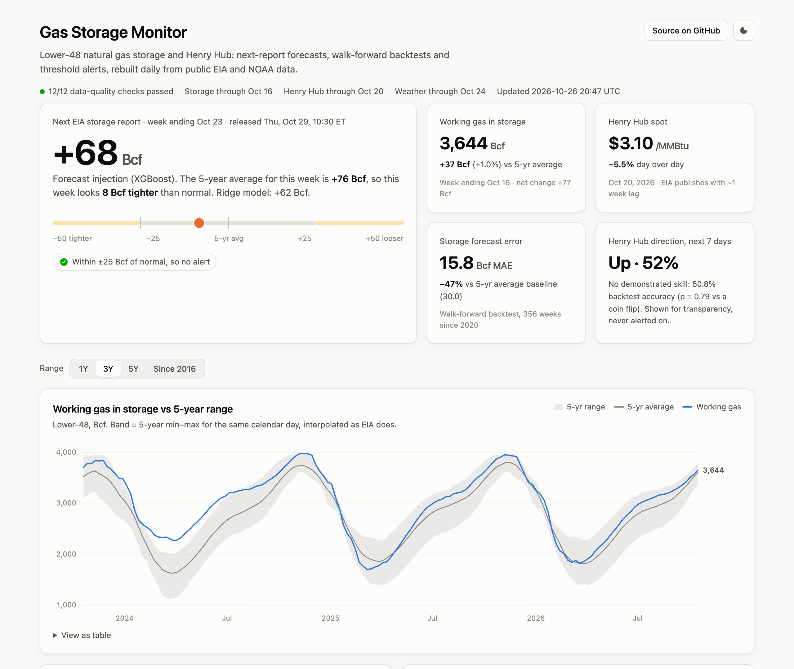
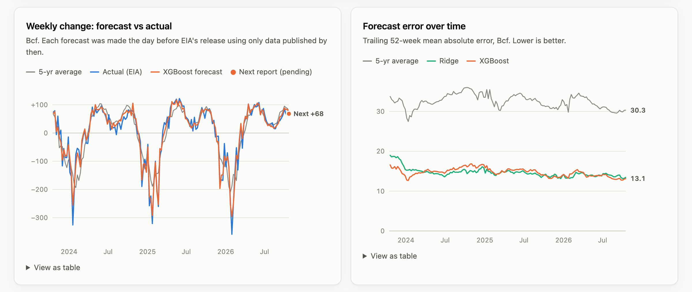
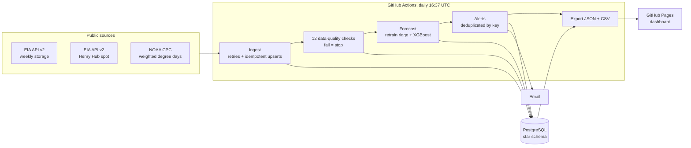

# Gas Storage & Henry Hub Forecaster

[](https://github.com/KaavinB/gas-storage-forecaster/actions/workflows/ci.yml)
[](https://github.com/KaavinB/gas-storage-forecaster/actions/workflows/daily.yml)

Every week, EIA's storage report tells the US gas market how much gas went into or came out of underground storage. This project forecasts that number before it's released, scores the forecast honestly against a naive baseline, and emails an alert when the expected week is far from normal or Henry Hub makes an outsized move. It runs every day on public EIA and NOAA data.

**Live dashboard: [kaavinb.github.io/gas-storage-forecaster](https://kaavinb.github.io/gas-storage-forecaster/)**, rebuilt daily by GitHub Actions.



## Results

Walk-forward backtest: 356 weekly reports from January 2020 to October 2026. Every forecast was made the day before EIA's release using only data published by then, with models retrained before each forecast.

**Weekly Lower-48 storage change (Bcf)**

| Model | MAE | RMSE | vs 5-yr baseline | Diebold–Mariano p |
|---|---:|---:|---:|---:|
| 5-year average (naive baseline) | 30.0 | 43.6 | — | — |
| Ridge regression | 16.1 | 22.4 | −46.3% | < 0.001 |
| **XGBoost** | **15.8** | **21.4** | **−47.3%** | **< 0.001** |

Both models beat the baseline in every year from 2020 to 2026. The gain is largest in winter, where withdrawal-season MAE falls from 49.9 to 20.6 Bcf.

**Henry Hub direction (next 7 days' average vs the prior 7 days')**

| Model | Accuracy | 95% CI | p vs coin flip |
|---|---:|---:|---:|
| Persistence (naive baseline) | 46.0% | 41–51% | 0.15 |
| Majority class | 48.6% | 43–54% | 0.63 |
| Ridge logistic | 50.8% | 46–56% | 0.79 |
| XGBoost | 46.0% | 41–51% | 0.15 |

**No model forecasts price direction better than a coin flip, and I report that as is.** Storage follows weather you can observe before the report, so it is forecastable. Price is set by a market that has already absorbed that information, faster than free, week-lagged data arrives. The direction forecast stays on the dashboard, labeled as having no skill, and never triggers an alert.

Full tables, including per-year and per-season error, the largest misses and model drivers, are in [`reports/backtest_results.md`](reports/backtest_results.md).



## Why this matters to a gas trading and logistics business

- **The weekly storage number moves prices.** Thursday's release is the most-watched data point in US gas. When it misses expectations by 20–30 Bcf, prices move. Knowing whether the week is likely to come in tighter or looser than normal shapes hedging and timing for purchases and sales.
- **Storage relative to the 5-year average reflects market tightness.** A deficit going into winter supports prices; a surplus weighs on them. That matters to anyone buying gas to compress, liquefy and truck (CNG/LNG virtual pipelines), and to producers deciding whether to sell now or later.
- **Alerts replace screen-watching.** Thresholds live in config. Each alert is logged and emailed exactly once, and rule thresholds were set from backtest hit rates rather than guessed.
- **Trust is designed in.** The pipeline won't publish on bad data, every number on the dashboard can be traced to a table, and the model that doesn't work is labeled as such.

## How it works



### Data

| Source | Series | Frequency | Notes |
|---|---|---|---|
| [EIA API v2](https://www.eia.gov/opendata/) `natural-gas/stor/wkly` | `NW2_EPG0_SWO_R48_BCF` Lower-48 working gas | weekly (Friday) | Released Thursday 10:30 ET for the week ending the prior Friday |
| [EIA API v2](https://www.eia.gov/opendata/) `natural-gas/pri/fut` | `RNGWHHD` Henry Hub spot | daily | EIA republishes weekly, about one week behind |
| [NOAA CPC](https://ftp.cpc.ncep.noaa.gov/htdocs/degree_days/weighted/daily_data/) | CONUS HDD weighted by **gas-heated homes**, CDD weighted by population | daily | About 2 days behind; history from 2000 |

The CPC gas-home-weighted HDD is a better demand signal than plain population weighting, because it counts cold only where homes actually heat with gas.

### Schema (PostgreSQL)

`dim_date` · `fact_storage_weekly` · `fact_gas_price_daily` · `fact_weather_daily` · `fact_forecast` · `alerts` · `dq_results` · `etl_runs`

Fact tables hold only raw source values. Derived numbers live in SQL views and functions, so EIA revisions flow through automatically. The upsert only updates rows whose values actually changed, so a re-run writes 0 rows and `updated_at` records real revisions.

The 5-year average follows [EIA's methodology](https://ir.eia.gov/ngs/methodology.html): weekly levels are interpolated to daily values and compared on the same calendar day across the prior five years. The result is within 1.8 Bcf (0.05%) of EIA's published figure for the latest week; EIA computes from a separate historical-estimates database.

### Forecast timing and leakage control

Forecasts are issued on **Wednesday, the day before the release**, which is when analysts submit their estimates. On that day the target week has already ended, so all seven days of its weather are known. Each source has an explicit availability rule in [`config/settings.yaml`](config/settings.yaml), applied identically in the backtest and the live job:

| Data | Usable on issue date D when |
|---|---|
| Storage | `release_date <= D` |
| Degree days | `obs_date + 2 days <= D` |
| Henry Hub | `price_date + 7 days <= D` |

- **Training labels are embargoed until published.** A price label needs the next week's prices, so it can't be used in training until 14 days after its issue date.
- **[`tests/test_features.py`](tests/test_features.py) scrambles every value published after the issue date and asserts that no feature changes.** With a deliberately planted one-day off-by-one leak, the test fails, so it really does guard against look-ahead.

### Features ([`models/features.py`](models/features.py))

- 5-year average change for the target week (the naive forecast)
- Last two reported changes, and how far the last 1 and 4 reports deviated from their 5-year averages
- Storage surplus or deficit vs the 5-year average
- Target-week and prior-week HDD/CDD, their anomalies vs trailing 10-year normals, and the change in anomaly
- Henry Hub level, 5- and 20-day momentum, 20-day volatility, and price vs its 60-day average
- Calendar: day-of-year sine/cosine, withdrawal-season flag, and a flag for weeks containing Thanksgiving, Christmas or New Year

The storage models predict the **deviation from the 5-year average** and add it back. The seasonal shape is already known, and tree models can't extrapolate a raw level beyond their training range. Hyperparameters were fixed up front and never tuned on the test period.

### Data quality and alerts

- **12 checks:** freshness against each source's normal lag, missing weeks or days, Friday-only storage weeks, and value ranges. Thresholds were set from the data. For example, a 5-day Henry Hub gap is normal when Thanksgiving falls on a Thursday.
- **Warn-only spike check:** Henry Hub hit $30.72 on 2026-01-23 during the January 2026 cold snap. Halting the pipeline then would stop forecasts and alerts exactly when a desk needs them, so the big-move check warns instead of failing.
- **Alert rules:**
  - The storage forecast is more than **25 Bcf** from the 5-year average. In the backtest this fired on about 27% of weeks, and when it did, the forecast was on the correct side of normal 98% of the time.
  - Henry Hub spot moves more than **10%** day over day, about 25 days a year. A 5% threshold would have fired on about 85 days a year.
  - An alert escalates to critical at 2× its threshold.

## Run it

Requirements: Docker, [uv](https://docs.astral.sh/uv/), and a free [EIA API key](https://www.eia.gov/opendata/register.php).

```bash
make setup          # install Python 3.12 deps, create .env from .env.example
# put EIA_API_KEY in .env (SMTP settings optional; alerts are logged either way)
make all            # Postgres -> full history -> backtest -> daily pipeline -> dashboard data
make site           # serve the dashboard at http://localhost:8000
```

| Target | What it does |
|---|---|
| `make ingest` / `ingest-full` | Incremental / full load from EIA and NOAA |
| `make dq` | Data-quality checks; exits non-zero on failure |
| `make backtest` | Walk-forward backtest (about 3 min); writes `reports/backtest_results.md` |
| `make forecast` | Retrain on everything published and store today's forecasts |
| `make alerts` | Evaluate rules, log alerts, email new ones |
| `make daily` | ingest → dq → forecast → alerts → dashboard export |
| `make test` | 43 tests: unit tests, plus integration tests against the real schema |

Production runs the same commands in [`.github/workflows/daily.yml`](.github/workflows/daily.yml) against a hosted Postgres (Neon). Secrets are GitHub Actions secrets and are never committed.

```
ingestion/   EIA + CPC clients, upsert loader, data-quality checks
sql/         star schema, EIA-method 5-year function and views
models/      features, model registry, walk-forward backtest, live forecast, metrics
alerts/      rules, email delivery, idempotent alert log
dashboards/  JSON/CSV export and the static dashboard (plain JS + SVG, no chart library)
tests/       pytest suite, including the look-ahead leakage test
```

## Limitations

- **Revised data, not first-release data.** The backtest uses today's revised EIA and CPC values rather than the numbers as first published, which can make it slightly optimistic.
- **Reclassifications are in the target.** The API publishes storage levels, so EIA reclassifications between working and base gas land in the weekly change. Week ending 2021-06-11 shows +16 Bcf, while EIA's implied physical flow was about +67 Bcf.
- **Extreme cold is underpredicted.** The largest misses (Feb 2021, Jan 2024, Jan 2026) were the coldest weeks in the sample. The model called large withdrawals but not the full size, because tree and ridge models compress extremes, and supply losses such as production freeze-offs aren't in the features. Daily production data would be the next addition.
- **Release dates are estimated.** EIA's API has no publication timestamp, so releases are assumed to be Thursday (week ending + 6 days). Holiday shifts are rare and only make the estimate conservative.
- **Price inputs are about a week late.** Henry Hub comes from EIA with that lag. A commercial real-time feed (NGI, ICE) would be needed for any serious price model.
- **Single region.** Lower-48 total only. The EIA API also has five storage regions, which would be a natural extension.

## Built with

Python 3.12 · PostgreSQL 16 · psycopg 3 · pandas · scikit-learn · XGBoost · pytest · ruff · Docker · GitHub Actions · GitHub Pages
